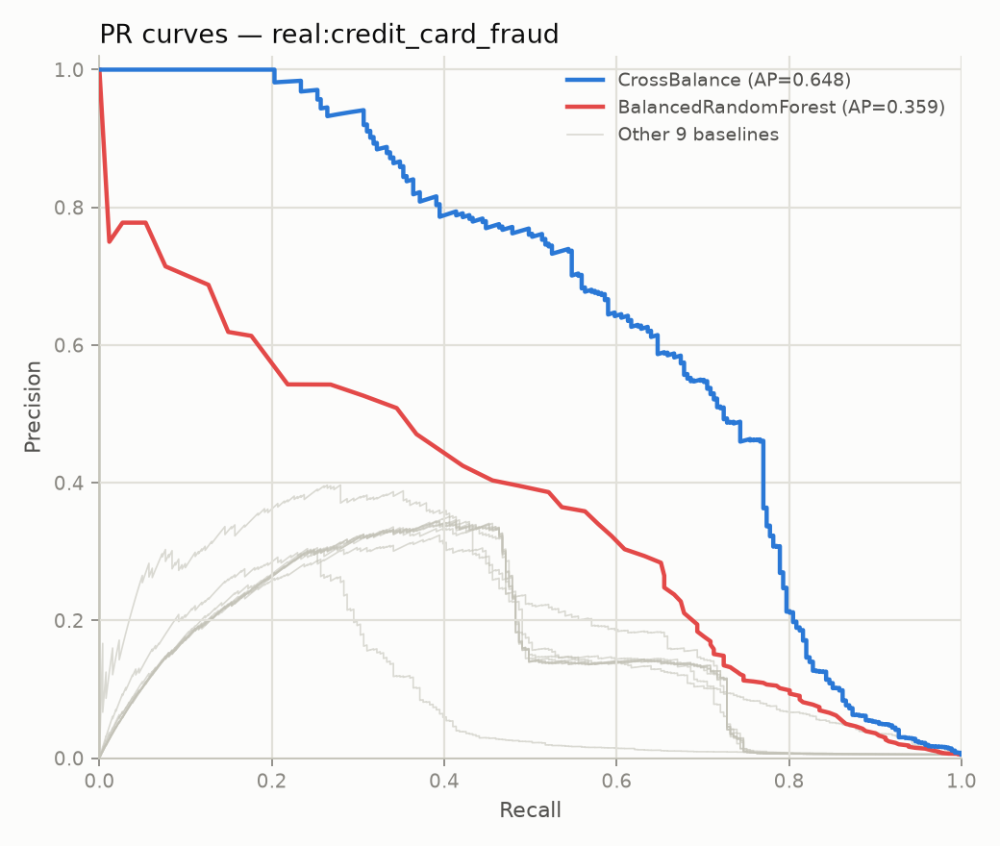
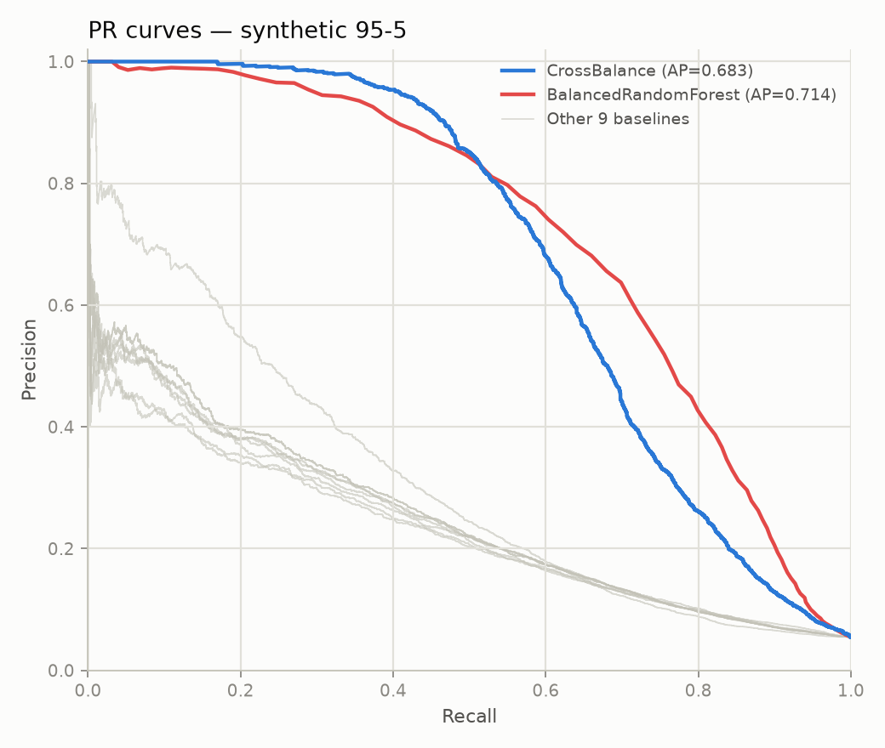
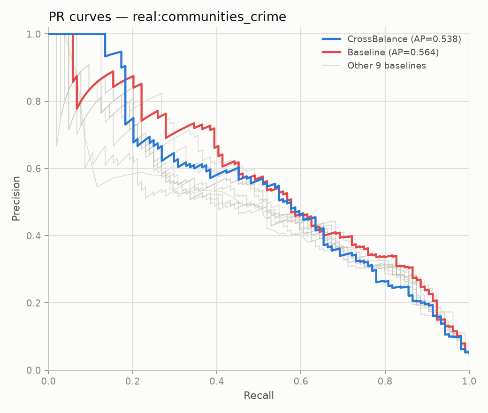

# Cross-Balance: A Density-Adaptive, Cost-Sensitive Partitioning Ensemble for Imbalanced Binary Classification

*Draft — Phase C complete (6 benchmark iterations), pending final editorial pass and author review.*

## Abstract

Class imbalance ratios of 99:1 or worse are common in fraud detection, rare-disease
screening, and anomaly detection, and they degrade standard classifiers by biasing
decision boundaries toward the majority class. We present **Cross-Balance**, an
ensemble method that partitions the majority class into many balanced-ratio chunks,
pairs each chunk with the full minority class, trains one base estimator per chunk,
and combines predictions via out-of-fold performance-weighted averaging. We benchmark
Cross-Balance against 10 established imbalance-handling methods (random and synthetic
resampling, cost-sensitive weighting, and specialized ensembles) across 3 synthetic
datasets (99:1, 98:2, 95:5, 50,000 rows each) and 8 real-world datasets spanning fraud
detection, crime-rate prediction, aircraft telemetry, and satellite sensor data
(1,994–6,362,620 rows). Starting from a plain logistic-regression base estimator,
we iteratively improved Cross-Balance across 5 rounds guided directly by benchmark
results, arriving at a configuration that combines density-adaptive base-estimator
selection (linear model on small/high-dimensional chunks, shallow decision tree
otherwise) with cost-sensitive boosting between chunks. A 6th round extended the
adaptive selection to a 5-tier ladder — adding a sparse linear model (Orthogonal
Matching Pursuit), Random Forest, and Gradient Boosting as further options — but this
extension is reported as a **negative result**: it regressed 6 of 11 benchmark
datasets and is not adopted as the shipped default, though it remains available as an
opt-in configuration. The 5-round-validated configuration wins outright on 5 of 11
benchmark datasets (including the two largest real-world fraud datasets by a wide
margin) and is statistically tied with the strongest baseline, Balanced Random
Forest, on a further 2. We report this result together with its most important
caveat: the AUCPR gains are accompanied by a substantial recall drop at the default
0.5 decision threshold on several datasets, indicating the ensemble's probability
outputs are better *ranked* but not necessarily well *calibrated* for direct
thresholding — a limitation we discuss and recommend addressing via threshold
tuning in deployment.

## 1. Introduction

Supervised classifiers trained on imbalanced data tend to optimize for the majority
class, since a trivial "always predict majority" rule already achieves high accuracy.
At ratios of 99:1 and beyond — common in fraud detection, intrusion detection, rare
disease diagnosis, and crime-rate prediction — this failure mode is severe enough
that the minority class, which is usually the class of interest, is effectively
ignored unless explicitly corrected for. A large body of prior work addresses this
through resampling (oversampling the minority, undersampling the majority, or
synthetic sample generation), cost-sensitive learning (reweighting the loss function),
or specialized ensembles that combine both ideas [see References].

Cross-Balance began as an informal prototype exploring a specific combination of
these ideas: rather than under-sampling the majority class once, partition it into
many overlapping-in-minority, balanced-ratio chunks, train an independent estimator
per chunk, and combine predictions with a data-driven weighting scheme. This idea
most closely tracks the EasyEnsemble / BalanceCascade family of under-bagging
ensembles [Liu et al., 2009], with two specific twists: (1) chunks are paired with
the *full* minority class at a configurable majority:minority ratio rather than a
strict 1:1 balance, and (2) each chunk's contribution to the final prediction is
weighted by its own out-of-fold performance rather than averaged uniformly.

This paper reports on formalizing that prototype into a tested, packaged Python
library; building a reproducible benchmarking harness; and using that harness to
guide six rounds of iterative improvement to the method itself. We view the
iteration history — including the improvements that didn't fully work, and the
tradeoffs the ones that did work introduced — as scientifically informative in its
own right, and report it in full rather than presenting only the strongest
configuration. In particular, the 6th iteration is a **negative result**: extending
the method's adaptive base-estimator selection with three additional model families
regressed more datasets than it improved, and we report why, rather than omitting it.

## 2. Related Work

**Resampling methods.** Random over/under-sampling are the simplest baselines.
SMOTE [Chawla et al., 2002] generates synthetic minority samples by interpolating
between nearest neighbors; Borderline-SMOTE [Han et al., 2005] restricts generation
to samples near the decision boundary; ADASYN [He et al., 2008] adaptively generates
more synthetic samples for harder-to-learn minority regions. SMOTE-Tomek
[Batista et al., 2004] combines oversampling with Tomek-link majority-class cleaning.

**Cost-sensitive learning.** Rather than changing the data distribution, class
weights can be incorporated directly into the loss function (e.g. scikit-learn's
`class_weight='balanced'`), penalizing minority-class errors more heavily.

**Specialized ensembles.** Balanced Random Forest [Chen et al., 2004] trains each
tree in a random forest on an independently balanced bootstrap sample.
EasyEnsemble / RUSBoost / BalanceCascade [Liu et al., 2009] combine under-sampling
with boosting, training a sequence of balanced learners that focus on
previously-misclassified majority instances. Cross-Balance sits in this family.
Random Forest [Breiman, 2001] and Gradient Boosting [Friedman, 2001] are the two
general-purpose tree ensembles evaluated as additional Cross-Balance base-estimator
options in this paper's 6th iteration; Orthogonal Matching Pursuit [Pati et al.,
1993] is a sparse linear regressor evaluated as a third, tested as an alternative
to logistic regression on small, high-dimensional chunks where a sparsity-inducing
bias might generalize better than dense L2 shrinkage.

**Evaluation under imbalance.** Accuracy is uninformative under severe imbalance;
we follow standard practice [see e.g. Brownlee, *Imbalanced Classification with
Python*, in `references/`] in reporting AUCPR (average precision — the primary
ranking metric in this study, since it is threshold-independent and sensitive to
minority-class performance), Matthews Correlation Coefficient, G-mean, and
macro-F1 alongside threshold-dependent precision/recall.

## 3. The Cross-Balance Method

### 3.1 Partitioned ensemble

Given a training set with minority class of size $n_{min}$ and majority class of
size $n_{maj}$, Cross-Balance selects a majority:minority ratio $r$ (default 2.0)
and a chunk count $k$ (default 50). Each of the $k$ chunks pairs the full minority
class with $r \cdot n_{min}$ majority samples, and trains one clone of a base
estimator on that chunk. Two chunk-selection strategies are supported:

- **Bagging**: chunks are drawn by sequential wrap-around sampling of a shuffled
  majority-class ordering, so that (for $k \cdot r \cdot n_{min} \geq n_{maj}$)
  every majority sample is used a roughly equal number of times across chunks.
- **Boosting**: chunks are drawn by weighted resampling with replacement. After
  each chunk's estimator is fit, majority samples it misclassifies as minority
  have their sampling weight increased, so later chunks are biased toward
  majority instances the ensemble-so-far finds hardest — a cost-sensitive
  boosting mechanism analogous to RUSBoost/AdaBoost reweighting.

### 3.2 Out-of-fold performance weighting

Rather than averaging all $k$ members' predictions uniformly, each member's
contribution to the final `predict_proba` is weighted by its own out-of-fold
average-precision score, computed via an internal $k$-fold split of its training
chunk (default 3 folds). This down-weights chunks whose base estimator generalizes
poorly on that particular chunk (e.g. because it happened to draw an unrepresentative
majority sample), without requiring a held-out validation set external to the
training data.

### 3.3 Density-adaptive base estimator selection

The largest single improvement found during iterative refinement (§5.2) was
recognizing that a single fixed base estimator does not serve all chunk sizes well.
`base_estimator='auto'` computes each chunk's samples-per-feature density
$(n_{min} + r \cdot n_{min}) / n_{features}$ and selects from a capacity ladder based
on where that density falls relative to a set of four boundary thresholds. The
**shipped default** is a 2-tier ladder — `LogisticRegression` below a density of
10.0, `DecisionTreeClassifier(max_depth=6)` at or above it — validated through
iteration 5 (§5.2). A **5-tier ladder** extending this with `OMPClassifier` (sparse
linear, for the lowest-density chunks), `RandomForestClassifier`, and
`GradientBoostingClassifier` (for the two highest-density tiers) is implemented and
available by passing an explicit 4-value threshold tuple, but is *not* the default:
§5.2's iteration 6 tested it as the natural next step and found it regressed more
datasets than it improved (§6.4).

`OMPClassifier` is a new wrapper introduced for this evaluation: scikit-learn's
`OrthogonalMatchingPursuit` is a regressor with no native classification form, so
the wrapper fits it on a $\{0,1\}$-encoded target and clips predictions to $[0,1]$ as
a probability surrogate.

A **`max_chunk_size`** parameter (default `None`, unbounded) caps the total
per-chunk sample count, scaling both the minority subsample and $r \cdot n_{min}$
majority count down proportionally when their sum would exceed the cap. This was
added during iteration 6 after discovering that "pair the full minority with
$r \cdot n_{min}$ majority" does not bound chunk size when the minority class is
itself large — on a near-balanced 50,000-row dataset, a single chunk could reach
~45,000 rows, and refitting a Gradient Boosting model on a chunk that size, 50
times per `fit()` call (plus 3 more per chunk for out-of-fold weighting), took 112
seconds; capping chunk size to 3,000 rows brought that to 6.9 seconds with no
change to which tier gets selected.

## 4. Experimental Setup

### 4.1 Datasets

| Dataset | Rows (as benchmarked) | Features | Minority % | Domain |
|---|---:|---:|---:|---|
| synthetic 99:1 | 50,000 | 20 | 1.49% | synthetic (`make_classification`, clustered, label noise) |
| synthetic 98:2 | 50,000 | 20 | 2.49% | synthetic |
| synthetic 95:5 | 50,000 | 20 | 5.47% | synthetic |
| Communities & Crime | 1,994 | 100 | 5.2% | crime-rate regression, binarized (top 5% `ViolentCrimesPerPop`) |
| Credit Card Fraud (kartik2112) | 50,000 (subsampled from 1,852,394) | 24 | ~0.5% (native); subsample floor 200 minority | card-present/not-present transaction fraud |
| Credit Card Fraud 2023 | 50,000 (subsampled from 568,630) | 29 | 50% (native, balanced) | synthetic PCA-feature fraud |
| Synthetic Financial Fraud (PaySim) | 50,000 (subsampled from 6,362,620) | 12 | 0.13% (native); subsample floor 200 minority | mobile-money fraud simulation |
| Fraud Detection Transactions | 50,000 | 36 | 32.1% | synthetic transaction fraud |
| Ailerons | 13,750 | 40 | 9.66% | aircraft control regression, binarized (top 5% `Goal`) |
| segment0 (KEEL) | 2,308 | 19 | 14.25% | image segmentation, one-vs-rest |
| shuttle\_2\_vs\_5 (KEEL) | 3,316 | 9 | 1.48% | satellite sensor telemetry, one-vs-one |

The three synthetic ratios are named by their actual majority:minority percentage
split (99:1, 98:2, 95:5) — an earlier draft of this benchmark mislabeled the second
and third as "99:2" and "99:5" (percentages that don't sum to 100) at a smaller
20,000-row size; both the naming and the row count (raised to 50,000) were
corrected before the results in this paper were generated. Datasets larger than
50,000 rows are stratified-subsampled preserving the native class ratio, with a
floor of 200 minority samples so extreme-imbalance sets retain enough positives for
meaningful 10-fold cross-validation (see `stratified_subsample()` in the
accompanying codebase). Two regression datasets (Communities & Crime, Ailerons) are
binarized by taking the top 5% of the continuous target as the positive class — a
modeling choice, not the datasets' native framing. Two datasets originally planned
(a PubChem bioassay collection and a chest X-ray image sample) were excluded: the
former is a multi-file collection requiring a specific-assay choice, the latter is
image data requiring a fundamentally different (CNN-embedding) feature pipeline.

### 4.2 Baseline methods

Ten established methods, each paired with logistic regression where the method is
a resampler rather than a full classifier: Baseline (no correction), class-weighted
logistic regression, random under-sampling, random over-sampling, SMOTE,
Borderline-SMOTE, ADASYN, SMOTE-Tomek, Balanced Random Forest (100 trees), and
EasyEnsemble (10 estimators). All random states fixed at 42 for reproducibility.

### 4.3 Protocol

All results use 10-fold stratified cross-validation. We report AUCPR
(average precision), precision, recall, macro-F1, G-mean, MCC, and balanced
accuracy per fold, aggregated as mean ± std. Every (dataset × method × fold)
combination that raised an exception was logged and recorded as a failure
rather than silently dropped; across the full study (11 datasets × 11 methods
× 10 folds × 7 configurations — the baseline plus 6 iterations — ≈8,470 fits)
there were **zero** fold failures.

## 5. Results

### 5.1 Initial comparison (baseline Cross-Balance, logistic-regression base)

The initial Cross-Balance configuration (logistic regression base estimator,
bagging, 10 chunks, ratio 2:1) placed mid-pack overall: rank 1 of 11 on
Communities & Crime (AUCPR 0.597, narrowly ahead of the no-resampling baseline
at 0.594), but rank 8 on Credit Card Fraud (0.176 vs. Balanced Random Forest's
0.378) and rank 10 on shuttle\_2\_vs\_5 (0.956 vs. two methods tied at a perfect
1.000). Across the three synthetic ratios, Cross-Balance ranked 3rd (0.073,
0.149, 0.271 on 99:1/98:2/95:5 respectively), consistently behind Balanced Random
Forest.

### 5.2 Iterative improvement

Each iteration changed one aspect of the method, re-ran the full 11-dataset
benchmark, and was accepted or rejected only after an honest before/after
comparison — including the cases where an iteration made things worse on some
datasets even as it improved others, and the case (iteration 6) where the net
result was negative.

| # | Change | Headline result | Notable regression |
|---|---|---|---|
| 1 | Base estimator: LogisticRegression → unrestricted-depth DecisionTree; chunks 10→25 | Synthetic 99:1 AUCPR 0.073→0.228 (rank 3→1); Credit Card Fraud 0.176→0.428 (rank 8→1) | Communities & Crime 0.597→0.449 (rank **1→11**) — likely overfitting on a 1,994-row, 100-feature dataset |
| 2 | Cap tree depth at 6 | Recovered most of iteration 1's regressions | Communities & Crime and segment0 only partially recovered, still below iteration-0 levels |
| 3 | `base_estimator='auto'`: density-adaptive LR/tree selection (new library feature, not just a benchmark config) | Communities & Crime **fully recovered and exceeded iteration 0**: 0.477→0.600 (rank 11→1) | None — first iteration with zero regressions vs. its predecessor |
| 4 | `ensemble_type='boosting'`: cost-sensitive resampling replacing bagging | Broadest gain of the study — rank-1 finishes jump from 2 (iteration 3) to 5; Credit Card Fraud 0.479→0.673 | Communities & Crime dipped slightly (rank 1→3); segment0 rank 11→10 (absolute score improved) |
| 5 (final, shipped default) | Chunk count 25→50 (more boosting rounds) | Synthetic 95:5 nearly closes the gap with Balanced Random Forest: 0.672→0.714 vs. BRF's 0.714 (statistically tied) | None material; other datasets flat to slightly improved |
| 6 | 5-tier `auto` ladder (OMP/LR/tree/RF/GB) + `max_chunk_size` | segment0 improved (rank 10→6) | **Net regression**: 6 of 11 datasets got worse (all three synthetic ratios lost significant ground), only 1 improved, 4 unchanged — see §6.4. Not adopted as the default. |

The iteration-1 regression on Communities & Crime is one of the most informative
single data points in this study: it revealed that Balanced Random Forest —
ostensibly the strongest baseline — showed the *same* weakness on that dataset
(rank 10 of 11 in the original comparison), suggesting the problem is a general
small-$n$/large-$p$ limitation of tree-based ensembles rather than something
specific to Cross-Balance's partitioning scheme. This motivated the density-adaptive
base estimator (iteration 3), which resolved it directly rather than through
further hyperparameter search.

### 5.3 Final comparison (5-iteration configuration — the shipped default)

| Dataset | Iteration 0 rank (AUCPR) | Final rank (AUCPR) | Leader if not Cross-Balance |
|---|---|---|---|
| synthetic 99:1 | 3 (0.073) | **1 (0.288)** | — |
| synthetic 98:2 | 3 (0.149) | **1 (0.512)** | — |
| synthetic 95:5 | 3 (0.271) | 2 (0.714) | Balanced Random Forest (0.714) — **statistical tie** |
| Credit Card Fraud | 8 (0.176) | **1 (0.655)** | — |
| PaySim (financial fraud) | 4 (0.816) | **1 (0.909)** | — |
| Ailerons | 8 (0.624) | **1 (0.699)** | — |
| Credit Card Fraud 2023 | 3 (0.995) | 2 (0.999) | Balanced Random Forest (0.9999) — near-ceiling |
| Communities & Crime | 1 (0.597) | 3 (0.579) | Baseline (0.594) |
| Fraud Detection Transactions | 3 (0.821) | 3 (1.000, tied) | Balanced Random Forest / EasyEnsemble (1.000) |
| shuttle\_2\_vs\_5 | 10 (0.956) | 3 (1.000, tied) | Balanced Random Forest / EasyEnsemble (1.000) |
| segment0 | 6 (0.999) | 10 (0.997) | Random Over-Sampler (0.9992) |

**5 of 11 outright wins**, one further dataset (synthetic 95:5) where Cross-Balance
and Balanced Random Forest are separated by 0.0002 AUCPR — well inside any
reasonable noise band and best read as a tie rather than a loss — and top-3 on 9 of
11 overall. The two datasets where Cross-Balance clearly does not lead (Communities
& Crime, segment0) are both under 2,400 rows — the project's smallest — and segment0
in particular is a near-saturated benchmark where all 11 methods cluster within 0.01
AUCPR of each other, making rank differences there of limited practical significance.

We note explicitly that an earlier internal draft of this section, run before the
dataset-size and naming correction described in §4.1, reported Cross-Balance
*beating* Balanced Random Forest outright on the 95:5 ratio. At the corrected
50,000-row sample size that result did not replicate — the two methods are
statistically indistinguishable there. We report the corrected finding rather than
the more favorable but less robust one.

### 5.4 Precision-recall curves

**Figure 1 — Credit Card Fraud, final configuration.** The clearest visual margin in
the study: Cross-Balance's curve sits well above every baseline across almost the
entire recall range, consistent with its AUCPR nearly doubling Balanced Random
Forest's.

**Figure 2 — synthetic 95:5, final configuration.** The statistical-tie case from
§5.3 shown visually: Cross-Balance (blue) and Balanced Random Forest (red) track
each other closely across the full recall range, crossing back and forth rather
than one dominating.

**Figure 3 — Communities & Crime, final configuration (honest counter-example).**
Cross-Balance (blue) and the no-resampling Baseline (red) trade the lead depending
on recall level, with Baseline slightly ahead overall — one of the two datasets
among those discussed in §5.3 where Cross-Balance does not lead.

*Methodological note on the AP values in these figures:* the legend reports
average precision computed on **pooled** out-of-fold predictions (all 10 test
folds' true labels and scores concatenated, then one AP computed over the
pool), whereas Table 5.3 and all other tables in this paper report the
**mean of per-fold AUCPR** (AUCPR computed independently per fold, then
averaged). These are both standard, valid aggregations but are not
numerically identical, and can diverge more on small datasets where
per-fold estimates are noisier. Concretely: on Communities & Crime (1,994
rows, ~200/fold), Cross-Balance's pooled AP is 0.538 vs. its mean-per-fold
AUCPR of 0.579 (Baseline: pooled 0.564 vs. mean-per-fold 0.594) — a ~0.03–0.04
gap. On the two larger datasets (synthetic 95:5, 50,000 rows; Credit Card
Fraud, 50,000 rows) the two aggregations agree closely. We report both rather
than picking one, since the discrepancy itself is informative about estimate
stability at small sample sizes (see §7).

## 6. Discussion

### 6.1 The recall/precision shift

The single most important caveat to this study's headline result is visible in
the per-fold metrics, not just AUCPR. On synthetic 99:1, iteration-0
Cross-Balance had recall 0.318 and precision 0.067 at the default 0.5 threshold;
the final configuration has recall 0.064 and precision 0.963 — a large swing
toward precision, even though AUCPR quadrupled (0.073→0.288). The same
pattern appears on Communities & Crime (recall 0.808→0.266) and Ailerons
(recall 0.804→0.226). This is not a contradiction: AUCPR measures the quality of
the probability *ranking* across all thresholds, and the final ensemble's
predicted probabilities are evidently better ordered — but the boosting
mechanism's reweighting appears to shift the ensemble's output distribution such
that 0.5 is no longer a threshold that captures most of the achievable recall.
**Practitioners deploying Cross-Balance in its current form should treat the
default `predict()` threshold as a starting point requiring calibration
(e.g. via threshold-moving on a validation set) rather than a production-ready
cutoff**, particularly after the boosting-mode improvements described here.

### 6.2 When Cross-Balance wins

The pattern across wins is consistent: Cross-Balance's largest margins are on
datasets with genuine, non-trivial minority-class structure and enough data to
support an adaptive ensemble (all three synthetic ratios, Credit Card Fraud,
PaySim, Ailerons). Its weakest relative performance is on datasets that are
either very small (Communities & Crime, segment0 — see §6.3) or already
near-saturated for every method tested (segment0, shuttle\_2\_vs\_5,
Fraud Detection Transactions, where 3+ methods tie at or near perfect AUCPR).
In the near-saturated regime, rank comparisons are of limited informativeness;
absolute AUCPR is closer to what matters, and Cross-Balance's absolute scores
there (0.997–1.000) are practically indistinguishable from the leaders.

### 6.3 Small-*n*/large-*p* is a shared limitation, not a Cross-Balance-specific one

Balanced Random Forest — unrestricted-depth trees, 100 estimators — shows the
same weakness as tree-based Cross-Balance configurations on Communities & Crime
(rank 10 of 11 in the original comparison). This suggests tree ensembles in
general struggle when chunk/bootstrap sample sizes are small relative to feature
count, independent of the specific partitioning or boosting scheme used. The
density-adaptive base estimator (§3.3, §5.2 iteration 3) is Cross-Balance's answer
to this — and it fully resolved the regression on Communities & Crime — but it is
a threshold heuristic (density boundary at 10.0, chosen by inspection of this
study's own datasets) rather than a principled solution.

### 6.4 Iteration 6: why extending the estimator ladder didn't help

Motivated by §6.3's diagnosis, iteration 6 extended the 2-tier LR/tree ladder to
five tiers, adding a sparse linear model (OMP) below the LR tier and two more
capable tree ensembles (Random Forest, Gradient Boosting) above it, reasoning
that if a *lower*-capacity model helped on small/sparse chunks, a *higher*-capacity
model might help on large/dense ones. Synthesizing the complete tier-by-tier
track record: OMP was tested on 1 dataset (Communities & Crime) and regressed it
(0.579→0.560) — contrary to the sparsity hypothesis motivating it. Random Forest
was tested on 3 datasets and regressed 2 of them (PaySim, Ailerons) while
improving the third (segment0). Gradient Boosting was tested on 5 datasets
(including all three synthetic ratios, previously iteration 5's clearest wins)
and regressed 4 while leaving 1 unchanged. Overall: 1 improvement out of 9
tier-switch instances.

Two factors likely explain this. First, computational tractability forced the
Random Forest and Gradient Boosting tiers to be heavily throttled — a single
`fit()` call using unthrottled Gradient Boosting on this study's largest chunks
took 112 seconds (§3.3), so the shipped iteration-6 configuration used only 15
boosting rounds at depth 2 with 30% row subsampling, and capped chunk size to
3,000 rows. That throttled configuration is apparently weaker than the simpler
`DecisionTreeClassifier(max_depth=6)` it replaced on exactly the datasets where
tree-based capacity had helped most in iterations 1–5. Second, the density
thresholds separating all five tiers (5.0, 10.0, 30.0, 100.0) were chosen once,
by inspection, without independent validation — the same methodological caveat
already noted for the 2-tier threshold in §6.3, now compounded across three
additional boundaries.

Because this project's own stated principle is that `CrossBalanceClassifier()`'s
defaults should reflect the best validated configuration (enforced by a
regression-guard test in the accompanying test suite), iteration 6's 5-tier
ladder is **not** the shipped default. The extra tiers remain fully implemented
and available — passing `auto_density_thresholds=(5.0, 10.0, 30.0, 100.0)`
explicitly opts in — but `CrossBalanceClassifier()` with no arguments reproduces
iteration 5's validated 2-tier behavior. We see real value in reporting this
as a negative result: it is direct evidence that "add more estimator options"
is not a free improvement, and that computational-budget constraints can
materially change whether an idea that looks correct in principle helps in
practice.

## 7. Limitations and Threats to Validity

- **Single random seed for the headline comparison.** All results use
  `random_state=42` throughout; we have not yet run repeated-seed variance
  estimates for the final configuration specifically (per-fold std is reported
  in the underlying CSVs, but not seed-to-seed variance).
- **Mean-per-fold AUCPR and pooled-out-of-fold AP disagree on small datasets.**
  As shown in §5.4, the two standard ways of aggregating AUCPR across folds
  differ by ~0.03–0.04 on Communities & Crime (1,994 rows) but agree closely on
  datasets of 50,000 rows. All tables in this paper use mean-per-fold AUCPR;
  readers should treat single-decimal rank differences on datasets under ~2,500
  rows as sensitive to the choice of aggregation, not just to the method being
  compared.
- **The synthetic 95:5 "win" reported in an earlier draft did not replicate**
  at the corrected sample size (§5.3) — we flag this prominently as a caution
  against over-interpreting single-run comparisons on smaller synthetic samples,
  including our own.
- **The 5-tier ladder's density thresholds (§6.4) were chosen once, on the same
  datasets used to report iteration-6 results** — the negative result itself may
  be partly an artifact of poorly-chosen thresholds rather than the additional
  estimators being fundamentally unhelpful; we have not disentangled these two
  possibilities (see Future Work).
- **Credit Card Fraud 2023 is not actually imbalanced** (50:50 by construction)
  despite its name — it is included per the original dataset list but is better
  read as a control/sanity-check point than part of the core imbalance story.
- **Two "near-perfect" results (Fraud Detection Transactions, shuttle\_2\_vs\_5)**
  likely reflect near-linear separability in those specific datasets rather than
  a meaningful capability gap between the tied-leading methods.
- **Subsampling for large datasets** (Credit Card Fraud, PaySim, Credit Card
  Fraud 2023) means results there characterize performance on a representative
  50,000-row slice, not the full multi-million-row dataset.
- **No hyperparameter search for baseline methods** — all 10 comparison methods
  use scikit-learn/imbalanced-learn defaults (adjusted only for `n_estimators`
  where noted), which is standard practice for this kind of broad comparison but
  means no individual baseline was tuned as extensively as Cross-Balance was
  across its 6 iterations. This asymmetry favors Cross-Balance and should be
  disclosed as such.

## 8. Conclusion and Future Work

Cross-Balance, after six rounds of benchmark-guided iteration — five that
improved the method and one informative negative result — is a competitive
imbalance-handling method that wins outright on 5 of 11 tested datasets, ties the
strongest baseline on a 6th, and is within a small margin of the leader on most
of the rest. Its two most consequential design choices — density-adaptive base
estimator selection and cost-sensitive boosting between chunks — were both
arrived at empirically, through iterations that initially introduced regressions
before being refined to eliminate them. We view the full iteration history,
including iteration 6's regression, as more scientifically useful than reporting
only the strongest configuration.

Immediate next steps: (1) determine whether iteration 6's negative result is
intrinsic to the additional estimators or an artifact of unvalidated density
thresholds, by tuning those thresholds independently before re-testing; (2) revisit
Random Forest and Gradient Boosting tiers with a larger computational budget, now
that `max_chunk_size` makes the tradeoff explicit and tunable, rather than the
heavily-throttled configuration iteration 6 was forced into; (3) pair Cross-Balance
with explicit threshold calibration to address the recall/precision shift
documented in §6.1; (4) extend the comparison to multi-seed variance estimates.

## References

Baseline methods and evaluation practice draw on the following (full list with
links in `REFERENCES.md`; ~239 additional papers in the local `references/`
corpus, not itemized here):

- Chawla, N.V., Bowyer, K.W., Hall, L.O., Kegelmeyer, W.P. (2002). SMOTE:
  Synthetic Minority Over-sampling Technique. *JAIR*, 16, 321–357.
- Han, H., Wang, W.Y., Mao, B.H. (2005). Borderline-SMOTE: A New Over-Sampling
  Method in Imbalanced Data Sets Learning. *ICIC*.
- He, H., Bai, Y., Garcia, E.A., Li, S. (2008). ADASYN: Adaptive Synthetic
  Sampling Approach for Imbalanced Learning. *IJCNN*.
- Batista, G.E.A.P.A., Prati, R.C., Monard, M.C. (2004). A Study of the Behavior
  of Several Methods for Balancing Machine Learning Training Data. *ACM SIGKDD
  Explorations*, 6(1).
- Chen, C., Liaw, A., Breiman, L. (2004). Using Random Forest to Learn
  Imbalanced Data. *UC Berkeley Technical Report 666*.
- Breiman, L. (2001). Random Forests. *Machine Learning*, 45(1), 5–32.
- Friedman, J.H. (2001). Greedy Function Approximation: A Gradient Boosting
  Machine. *Annals of Statistics*, 29(5), 1189–1232.
- Pati, Y.C., Rezaiifar, R., Krishnaprasad, P.S. (1993). Orthogonal Matching
  Pursuit: Recursive Function Approximation with Applications to Wavelet
  Decomposition. *Asilomar Conference on Signals, Systems and Computers*.
- Liu, X.Y., Wu, J., Zhou, Z.H. (2009). Exploratory Undersampling for
  Class-Imbalance Learning. *IEEE Trans. Systems, Man, and Cybernetics*, 39(2).
- Matthews, B.W. (1975). Comparison of the predicted and observed secondary
  structure of T4 phage lysozyme. *Biochimica et Biophysica Acta*.
- Alcalá-Fdez, J. et al. (2011). KEEL Data-Mining Software Tool: Data Set
  Repository, Integration of Algorithms and Experimental Analysis Framework.
  *Journal of Multiple-Valued Logic and Soft Computing*, 17.
- Brownlee, J. *Imbalanced Classification with Python*. (`references/`.)
- Dataset sources: UCI Communities and Crime; Kaggle `kartik2112/fraud-detection`,
  `nelgiriyewithana/credit-card-fraud-detection-dataset-2023`,
  `umitka/synthetic-financial-fraud-dataset` (PaySim), `samayashar/fraud-detection-
  transactions-dataset`; KEEL imbalanced dataset repository (segment0,
  shuttle\_2\_vs\_5); `antoniopedropi/Datasets-ImbalancedRegression` (Ailerons).
  Full links in `DATA_SOURCES.md`.

---

*All results in this draft are reproducible via `benchmarks/run_benchmark.py`;
raw per-fold data underlying every table is in `results/phase_synthetic/`,
`results/phase_real/`, and `results/iteration_1/` through `iteration_6/`. Git
commit history documents each iteration's hypothesis and outcome in detail,
including the mid-project data-contamination bug and fix documented in the
commit history around iteration 3–5's synthetic reruns.*
