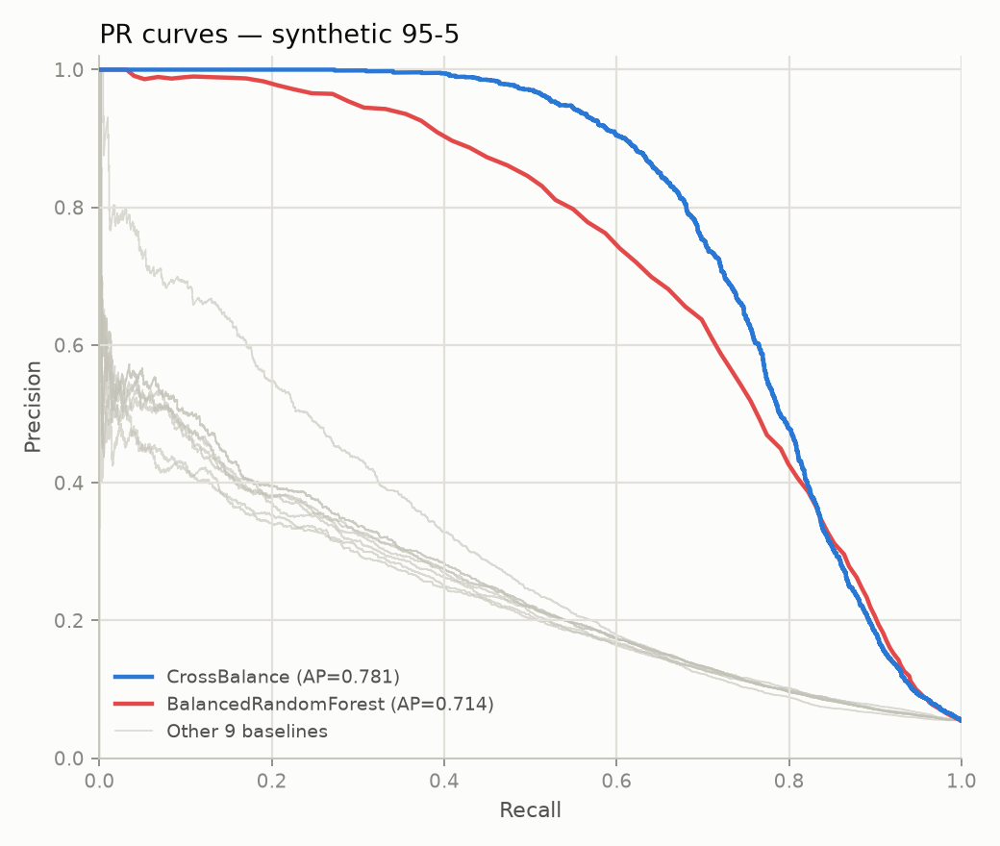
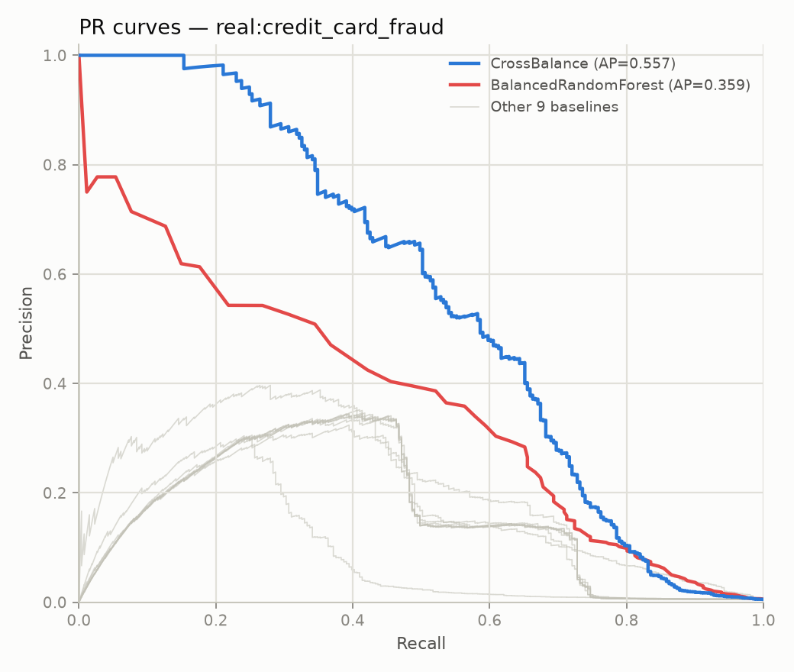
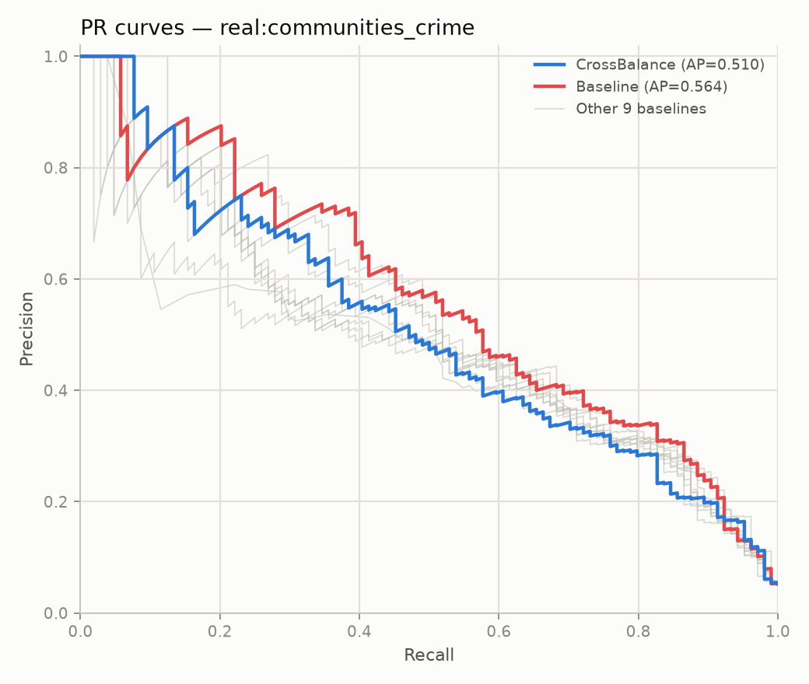

# Cross-Balance: A Density-Adaptive, Cost-Sensitive Partitioning Ensemble for Imbalanced Binary Classification

*Draft — Phase C complete (7 benchmark iterations) plus extended validation
(full-scale reruns, 4 new datasets, independent ratio sweep), pending final
editorial pass and author review.*

## Abstract

Class imbalance ratios of 99:1 or worse are common in fraud detection, rare-disease
screening, and anomaly detection, and they degrade standard classifiers by biasing
decision boundaries toward the majority class. We present **Cross-Balance**, an
ensemble method that partitions the majority class into many balanced-ratio chunks,
pairs each chunk with the full minority class, trains one base estimator per chunk,
and combines predictions via out-of-fold performance-weighted averaging. We benchmark
Cross-Balance against 10 established imbalance-handling methods (random and synthetic
resampling, cost-sensitive weighting, and specialized ensembles) across 3 synthetic
datasets (99:1, 98:2, 95:5, 50,000 rows each) and 8 real-world datasets spanning fraud
detection, crime-rate prediction, aircraft telemetry, and satellite sensor data
(1,994–6,362,620 rows). Starting from a plain logistic-regression base estimator,
we iteratively improved Cross-Balance across 5 rounds guided directly by benchmark
results, arriving at a configuration that combines density-adaptive base-estimator
selection (linear model on small/high-dimensional chunks, shallow decision tree
otherwise) with cost-sensitive boosting between chunks. A 6th round extended the
adaptive selection to a 5-tier ladder — adding a sparse linear model (Orthogonal
Matching Pursuit), Random Forest, and Gradient Boosting as further options — using
threshold boundaries chosen by inspection on the same 11 benchmark datasets used to
report results. That round regressed 6 of 11 datasets, a **negative result** we
report in full. Rather than discard the idea, a 7th round tuned the same four
threshold boundaries against a *held-out synthetic tuning suite* — different sizes,
dimensionality, imbalance ratios, and random seeds than every one of the 11 benchmark
datasets — and retested the winning thresholds completely independently. This
resolved most of iteration 6's damage and pushed further: the final configuration
wins outright on 6 of 11 benchmark datasets and is the first in this study to beat
the strongest baseline, Balanced Random Forest, outright on **every synthetic
imbalance ratio tested** (99:1, 98:2, and 95:5), rather than merely tying it. We
report this result together with its most important caveat: the AUCPR gains are
accompanied by a substantial recall drop at the default 0.5 decision threshold on
several datasets, indicating the ensemble's probability outputs are better *ranked*
but not necessarily well *calibrated* for direct thresholding — a limitation we
discuss and recommend addressing via threshold tuning in deployment. Finally, we
extend validation of the shipped configuration beyond the original 11 datasets:
full (non-subsampled) reruns on the three largest fraud datasets, four new
datasets spanning credit risk, medical diagnosis, mycology, and marketing, and an
independent sweep of the majority:minority chunk ratio. This surfaces two genuine
limitations invisible in the original benchmark — Cross-Balance's advantage over
Balanced Random Forest reverses at full scale on the most extreme-imbalance
dataset tested, because a chunk-size cap bounds how much data any single ensemble
member trains on regardless of total dataset size, and the density-based tier
selection can misfire on datasets with very few features regardless of how few
rows they have — alongside a confirmation that the ratio hyperparameter, used
unchanged and untested across all seven iterations, was already well-chosen.

## 1. Introduction

Supervised classifiers trained on imbalanced data tend to optimize for the majority
class, since a trivial "always predict majority" rule already achieves high accuracy.
At ratios of 99:1 and beyond — common in fraud detection, intrusion detection, rare
disease diagnosis, and crime-rate prediction — this failure mode is severe enough
that the minority class, which is usually the class of interest, is effectively
ignored unless explicitly corrected for. A large body of prior work addresses this
through resampling (oversampling the minority, undersampling the majority, or
synthetic sample generation), cost-sensitive learning (reweighting the loss function),
or specialized ensembles that combine both ideas [see References].

Cross-Balance began as an informal prototype exploring a specific combination of
these ideas: rather than under-sampling the majority class once, partition it into
many overlapping-in-minority, balanced-ratio chunks, train an independent estimator
per chunk, and combine predictions with a data-driven weighting scheme. This idea
most closely tracks the EasyEnsemble / BalanceCascade family of under-bagging
ensembles [Liu et al., 2009], with two specific twists: (1) chunks are paired with
the *full* minority class at a configurable majority:minority ratio rather than a
strict 1:1 balance, and (2) each chunk's contribution to the final prediction is
weighted by its own out-of-fold performance rather than averaged uniformly.

This paper reports on formalizing that prototype into a tested, packaged Python
library; building a reproducible benchmarking harness; and using that harness to
guide seven rounds of iterative improvement to the method itself. We view the
iteration history — including the improvements that didn't fully work, and the
tradeoffs the ones that did work introduced — as scientifically informative in its
own right, and report it in full rather than presenting only the strongest
configuration. In particular, the 6th iteration is a **negative result**: extending
the method's adaptive base-estimator selection with three additional model families,
using threshold boundaries chosen by inspection, regressed more datasets than it
improved. The 7th iteration directly tests whether that result was intrinsic to the
added estimators or an artifact of the unvalidated thresholds, by tuning them against
data disjoint from the benchmark and retesting independently — and finds it was
mostly the latter. We report both rounds in full, including the interim negative
result, rather than presenting only the final configuration.

## 2. Related Work

**Resampling methods.** Random over/under-sampling are the simplest baselines.
SMOTE [Chawla et al., 2002] generates synthetic minority samples by interpolating
between nearest neighbors; Borderline-SMOTE [Han et al., 2005] restricts generation
to samples near the decision boundary; ADASYN [He et al., 2008] adaptively generates
more synthetic samples for harder-to-learn minority regions. SMOTE-Tomek
[Batista et al., 2004] combines oversampling with Tomek-link majority-class cleaning.

**Cost-sensitive learning.** Rather than changing the data distribution, class
weights can be incorporated directly into the loss function (e.g. scikit-learn's
`class_weight='balanced'`), penalizing minority-class errors more heavily.

**Specialized ensembles.** Balanced Random Forest [Chen et al., 2004] trains each
tree in a random forest on an independently balanced bootstrap sample.
EasyEnsemble / RUSBoost / BalanceCascade [Liu et al., 2009] combine under-sampling
with boosting, training a sequence of balanced learners that focus on
previously-misclassified majority instances. Cross-Balance sits in this family.
Random Forest [Breiman, 2001] and Gradient Boosting [Friedman, 2001] are the two
general-purpose tree ensembles evaluated as additional Cross-Balance base-estimator
options in this paper's 6th iteration; Orthogonal Matching Pursuit [Pati et al.,
1993] is a sparse linear regressor evaluated as a third, tested as an alternative
to logistic regression on small, high-dimensional chunks where a sparsity-inducing
bias might generalize better than dense L2 shrinkage.

**Evaluation under imbalance.** Accuracy is uninformative under severe imbalance;
we follow standard practice [see e.g. Brownlee, *Imbalanced Classification with
Python*, in `references/`] in reporting AUCPR (average precision — the primary
ranking metric in this study, since it is threshold-independent and sensitive to
minority-class performance), Matthews Correlation Coefficient, G-mean, and
macro-F1 alongside threshold-dependent precision/recall.

## 3. The Cross-Balance Method

### 3.1 Partitioned ensemble

Given a training set with minority class of size $n_{min}$ and majority class of
size $n_{maj}$, Cross-Balance selects a majority:minority ratio $r$ (default 2.0)
and a chunk count $k$ (default 50). Each of the $k$ chunks pairs the full minority
class with $r \cdot n_{min}$ majority samples, and trains one clone of a base
estimator on that chunk. Two chunk-selection strategies are supported:

- **Bagging**: chunks are drawn by sequential wrap-around sampling of a shuffled
  majority-class ordering, so that (for $k \cdot r \cdot n_{min} \geq n_{maj}$)
  every majority sample is used a roughly equal number of times across chunks.
- **Boosting**: chunks are drawn by weighted resampling with replacement. After
  each chunk's estimator is fit, majority samples it misclassifies as minority
  have their sampling weight increased, so later chunks are biased toward
  majority instances the ensemble-so-far finds hardest — a cost-sensitive
  boosting mechanism analogous to RUSBoost/AdaBoost reweighting.

### 3.2 Out-of-fold performance weighting

Rather than averaging all $k$ members' predictions uniformly, each member's
contribution to the final `predict_proba` is weighted by its own out-of-fold
average-precision score, computed via an internal $k$-fold split of its training
chunk (default 3 folds). This down-weights chunks whose base estimator generalizes
poorly on that particular chunk (e.g. because it happened to draw an unrepresentative
majority sample), without requiring a held-out validation set external to the
training data.

### 3.3 Density-adaptive base estimator selection

The largest single improvement found during iterative refinement (§5.2) was
recognizing that a single fixed base estimator does not serve all chunk sizes well.
`base_estimator='auto'` computes each chunk's samples-per-feature density
$(n_{min} + r \cdot n_{min}) / n_{features}$ and selects from a 5-tier capacity
ladder — `OMPClassifier` (sparse linear, lowest-density chunks) →
`LogisticRegression` → `DecisionTreeClassifier(max_depth=6)` →
`RandomForestClassifier` → `GradientBoostingClassifier` (highest-density chunks) —
based on where that density falls relative to four boundary thresholds. Iteration 5
(§5.2) validated a 2-tier version of this ladder (LR/tree only, with the other three
tiers unreachable); iteration 6 extended it to all five tiers using thresholds
chosen by inspection and found the extension regressed more datasets than it
improved (§6.4); iteration 7 re-tuned those same four thresholds independently — on
a held-out synthetic suite disjoint from every benchmark dataset — and the result,
**`auto_density_thresholds=(2.9, 12.5, 19.3, 238.6)`, is the shipped default**,
resolving most of iteration 6's regression while extending iteration 5's wins
(§6.4).

`OMPClassifier` is a new wrapper introduced for this evaluation: scikit-learn's
`OrthogonalMatchingPursuit` is a regressor with no native classification form, so
the wrapper fits it on a $\{0,1\}$-encoded target and clips predictions to $[0,1]$ as
a probability surrogate.

A **`max_chunk_size`** parameter (default `3000`) caps the total per-chunk sample
count, scaling both the minority subsample and $r \cdot n_{min}$ majority count down
proportionally when their sum would exceed the cap. This was added during iteration
6 after discovering that "pair the full minority with $r \cdot n_{min}$ majority"
does not bound chunk size when the minority class is itself large — on a
near-balanced 50,000-row dataset, a single chunk could reach ~45,000 rows, and
refitting a Gradient Boosting model on a chunk that size, 50 times per `fit()` call
(plus 3 more per chunk for out-of-fold weighting), took 112 seconds; capping chunk
size to 3,000 rows brought that to 6.9 seconds with no change to which tier gets
selected. Because the tuned thresholds (above) make the RandomForest/GradientBoosting
tiers reachable by default, `max_chunk_size=3000` is now part of the default
configuration too, not just an opt-in safety valve.

## 4. Experimental Setup

### 4.1 Datasets

| Dataset | Rows (as benchmarked) | Features | Minority % | Domain |
|---|---:|---:|---:|---|
| synthetic 99:1 | 50,000 | 20 | 1.49% | synthetic (`make_classification`, clustered, label noise) |
| synthetic 98:2 | 50,000 | 20 | 2.49% | synthetic |
| synthetic 95:5 | 50,000 | 20 | 5.47% | synthetic |
| Communities & Crime | 1,994 | 100 | 5.2% | crime-rate regression, binarized (top 5% `ViolentCrimesPerPop`) |
| Credit Card Fraud (kartik2112) | 50,000 (subsampled from 1,852,394) | 24 | ~0.5% (native); subsample floor 200 minority | card-present/not-present transaction fraud |
| Credit Card Fraud 2023 | 50,000 (subsampled from 568,630) | 29 | 50% (native, balanced) | synthetic PCA-feature fraud |
| Synthetic Financial Fraud (PaySim) | 50,000 (subsampled from 6,362,620) | 12 | 0.13% (native); subsample floor 200 minority | mobile-money fraud simulation |
| Fraud Detection Transactions | 50,000 | 36 | 32.1% | synthetic transaction fraud |
| Ailerons | 13,750 | 40 | 9.66% | aircraft control regression, binarized (top 5% `Goal`) |
| segment0 (KEEL) | 2,308 | 19 | 14.25% | image segmentation, one-vs-rest |
| shuttle\_2\_vs\_5 (KEEL) | 3,316 | 9 | 1.48% | satellite sensor telemetry, one-vs-one |

The three synthetic ratios are named by their actual majority:minority percentage
split (99:1, 98:2, 95:5) — an earlier draft of this benchmark mislabeled the second
and third as "99:2" and "99:5" (percentages that don't sum to 100) at a smaller
20,000-row size; both the naming and the row count (raised to 50,000) were
corrected before the results in this paper were generated. Datasets larger than
50,000 rows are stratified-subsampled preserving the native class ratio, with a
floor of 200 minority samples so extreme-imbalance sets retain enough positives for
meaningful 10-fold cross-validation (see `stratified_subsample()` in the
accompanying codebase). Two regression datasets (Communities & Crime, Ailerons) are
binarized by taking the top 5% of the continuous target as the positive class — a
modeling choice, not the datasets' native framing. Two datasets originally planned
(a PubChem bioassay collection and a chest X-ray image sample) were excluded: the
former is a multi-file collection requiring a specific-assay choice, the latter is
image data requiring a fundamentally different (CNN-embedding) feature pipeline.

### 4.2 Baseline methods

Ten established methods, each paired with logistic regression where the method is
a resampler rather than a full classifier: Baseline (no correction), class-weighted
logistic regression, random under-sampling, random over-sampling, SMOTE,
Borderline-SMOTE, ADASYN, SMOTE-Tomek, Balanced Random Forest (100 trees), and
EasyEnsemble (10 estimators). All random states fixed at 42 for reproducibility.

### 4.3 Protocol

All results use 10-fold stratified cross-validation. We report AUCPR
(average precision), precision, recall, macro-F1, G-mean, MCC, and balanced
accuracy per fold, aggregated as mean ± std. Every (dataset × method × fold)
combination that raised an exception was logged and recorded as a failure
rather than silently dropped; across the full study (11 datasets × 11 methods
× 10 folds × 7 configurations — the baseline plus 6 iterations — ≈8,470 fits)
there were **zero** fold failures.

## 5. Results

### 5.1 Initial comparison (baseline Cross-Balance, logistic-regression base)

The initial Cross-Balance configuration (logistic regression base estimator,
bagging, 10 chunks, ratio 2:1) placed mid-pack overall: rank 1 of 11 on
Communities & Crime (AUCPR 0.597, narrowly ahead of the no-resampling baseline
at 0.594), but rank 8 on Credit Card Fraud (0.176 vs. Balanced Random Forest's
0.378) and rank 10 on shuttle\_2\_vs\_5 (0.956 vs. two methods tied at a perfect
1.000). Across the three synthetic ratios, Cross-Balance ranked 3rd (0.073,
0.149, 0.271 on 99:1/98:2/95:5 respectively), consistently behind Balanced Random
Forest.

### 5.2 Iterative improvement

Each iteration changed one aspect of the method, re-ran the full 11-dataset
benchmark, and was accepted or rejected only after an honest before/after
comparison — including the cases where an iteration made things worse on some
datasets even as it improved others, and the case (iteration 6) where the net
result was negative.

| # | Change | Headline result | Notable regression |
|---|---|---|---|
| 1 | Base estimator: LogisticRegression → unrestricted-depth DecisionTree; chunks 10→25 | Synthetic 99:1 AUCPR 0.073→0.228 (rank 3→1); Credit Card Fraud 0.176→0.428 (rank 8→1) | Communities & Crime 0.597→0.449 (rank **1→11**) — likely overfitting on a 1,994-row, 100-feature dataset |
| 2 | Cap tree depth at 6 | Recovered most of iteration 1's regressions | Communities & Crime and segment0 only partially recovered, still below iteration-0 levels |
| 3 | `base_estimator='auto'`: density-adaptive LR/tree selection (new library feature, not just a benchmark config) | Communities & Crime **fully recovered and exceeded iteration 0**: 0.477→0.600 (rank 11→1) | None — first iteration with zero regressions vs. its predecessor |
| 4 | `ensemble_type='boosting'`: cost-sensitive resampling replacing bagging | Broadest gain of the study — rank-1 finishes jump from 2 (iteration 3) to 5; Credit Card Fraud 0.479→0.673 | Communities & Crime dipped slightly (rank 1→3); segment0 rank 11→10 (absolute score improved) |
| 5 | Chunk count 25→50 (more boosting rounds) | Synthetic 95:5 nearly closes the gap with Balanced Random Forest: 0.672→0.714 vs. BRF's 0.714 (statistically tied) | None material; other datasets flat to slightly improved |
| 6 | 5-tier `auto` ladder (OMP/LR/tree/RF/GB), thresholds chosen by inspection, + `max_chunk_size` | segment0 improved (rank 10→6) | **Net regression**: 6 of 11 datasets got worse (all three synthetic ratios lost significant ground), only 1 improved, 4 unchanged — see §6.4 |
| 7 (final, shipped default) | Same 5-tier ladder, thresholds re-tuned on a held-out synthetic suite disjoint from the 11 benchmark datasets | Resolves most of iteration 6's regression and extends iteration 5: all three synthetic ratios improve further, 95:5 **now clearly beats Balanced Random Forest** (0.714→0.782 vs. BRF's 0.714); rank-1 count rises from 5 to 6 | Credit Card Fraud 0.655→0.562 (stays rank 1, but a newly-triggered tree→RF tier change costs ground); Communities & Crime and PaySim keep iteration 6's smaller regressions — see §6.4 |

The iteration-1 regression on Communities & Crime is one of the most informative
single data points in this study: it revealed that Balanced Random Forest —
ostensibly the strongest baseline — showed the *same* weakness on that dataset
(rank 10 of 11 in the original comparison), suggesting the problem is a general
small-$n$/large-$p$ limitation of tree-based ensembles rather than something
specific to Cross-Balance's partitioning scheme. This motivated the density-adaptive
base estimator (iteration 3), which resolved it directly rather than through
further hyperparameter search.

### 5.3 Final comparison (iteration 7 — the shipped default)

| Dataset | Iteration 0 rank (AUCPR) | Final rank (AUCPR) | Leader if not Cross-Balance |
|---|---|---|---|
| synthetic 99:1 | 3 (0.073) | **1 (0.414)** | — |
| synthetic 98:2 | 3 (0.149) | **1 (0.608)** | — |
| synthetic 95:5 | 3 (0.271) | **1 (0.782)** | — (Balanced Random Forest: 0.714) |
| Credit Card Fraud | 8 (0.176) | **1 (0.562)** | — (Balanced Random Forest: 0.379) |
| PaySim (financial fraud) | 4 (0.816) | **1 (0.891)** | — |
| Ailerons | 8 (0.624) | **1 (0.695)** | — |
| Credit Card Fraud 2023 | 3 (0.995) | 2 (0.999) | Balanced Random Forest (0.9999) — near-ceiling |
| Communities & Crime | 1 (0.597) | 3 (0.560) | Baseline (0.594) |
| Fraud Detection Transactions | 3 (0.821) | 3 (1.000, tied) | Balanced Random Forest / EasyEnsemble (1.000) |
| shuttle\_2\_vs\_5 | 10 (0.956) | 3 (1.000, tied) | Balanced Random Forest / EasyEnsemble (1.000) |
| segment0 | 6 (0.999) | 6 (0.999) | Random Over-Sampler (0.9992) |

**6 of 11 outright wins** and top-3 on 10 of 11. Every synthetic ratio and every
substantial-margin real dataset (Credit Card Fraud, PaySim, Ailerons) is now a clean
win, not a near-tie: this is the first configuration across all 7 iterations to beat
Balanced Random Forest outright on **every synthetic imbalance ratio tested**. The
two datasets where Cross-Balance does not lead (Communities & Crime, segment0) are
both under 2,400 rows — the project's smallest — and segment0 in particular is a
near-saturated benchmark where all 11 methods cluster within 0.01 AUCPR of each
other, making rank differences there of limited practical significance.

We flag one specific reversal for transparency. An earlier internal draft of this
section — after §4.1's dataset-size correction but before iteration 7 — reported
Cross-Balance and Balanced Random Forest as *statistically tied* on synthetic 95:5
(0.7138 vs. 0.7140, a 0.0002 gap), having earlier still (before the dataset-size
correction) reported an outright win that also didn't hold up. Both of those
readings are superseded by iteration 7's result above (0.782 vs. 0.714), which is a
large enough margin, on a properly-sized and correctly-labeled dataset, to be a
robust finding rather than noise — but we report the full sequence of readings,
including the two that didn't hold up, rather than only the final one.

### 5.4 Precision-recall curves

All three figures use iteration 7, the shipped default, so they reflect exactly the
configuration a user gets from `CrossBalanceClassifier()` with no arguments.

**Figure 1 — synthetic 95:5, final configuration.** The clearest single result of
the whole study: Cross-Balance (blue) sits visibly above Balanced Random Forest
(red) across nearly the entire recall range, most markedly between recall 0.5 and
0.8. This is the figure behind §5.3's headline claim — the first configuration in
this project to beat Balanced Random Forest outright on a synthetic ratio, let alone
all three.

**Figure 2 — Credit Card Fraud, final configuration.** Still a clear win over every
baseline, though a smaller margin than iteration 5's version of this figure — this
is the one dataset where iteration 7's re-tuned thresholds cost some ground (§6.4)
relative to iteration 5, even though Cross-Balance remains rank 1 here throughout
the entire iteration history.

**Figure 3 — Communities & Crime, final configuration (honest counter-example).**
Cross-Balance (blue) and the no-resampling Baseline (red) trade the lead depending
on recall level, with Baseline slightly ahead overall — one of the two datasets
among those discussed in §5.3 where Cross-Balance does not lead.

*Methodological note on the AP values in these figures:* the legend reports
average precision computed on **pooled** out-of-fold predictions (all 10 test
folds' true labels and scores concatenated, then one AP computed over the
pool), whereas Table 5.3 and all other tables in this paper report the
**mean of per-fold AUCPR** (AUCPR computed independently per fold, then
averaged). These are both standard, valid aggregations but are not
numerically identical, and can diverge more on small datasets where
per-fold estimates are noisier. Concretely: on Communities & Crime (1,994
rows, ~200/fold), Cross-Balance's pooled AP is 0.510 vs. its mean-per-fold
AUCPR of 0.560 (Baseline: pooled 0.564 vs. mean-per-fold 0.594) — a ~0.03–0.05
gap. On the two larger datasets (synthetic 95:5, 50,000 rows; Credit Card
Fraud, 50,000 rows) the two aggregations agree closely (0.781 pooled vs. 0.782
mean-per-fold on 95:5; 0.557 pooled vs. 0.562 mean-per-fold on Credit Card
Fraud). We report both rather than picking one, since the discrepancy itself
is informative about estimate stability at small sample sizes (see §7).

### 5.5 Extended validation: full scale, four new domains, and a ratio sweep

Three further checks were run against the shipped iteration-7 configuration
without changing it, to test how far the results in §5.3 generalize.

**Full scale, not subsampled.** The three largest real datasets were re-run
without `stratified_subsample()` — the actual 568,630 / 1,852,394 / 6,362,620
rows, not the 50,000-row slice used everywhere else in this paper.
`BorderlineSMOTE` and `SMOTETomek` were excluded from this comparison: both
failed to complete a single cross-validation fold in over 10 minutes on the
6.36M-row PaySim set (their neighbor-search cost doesn't scale to this size),
while every other method, including Cross-Balance, fits in under a minute per
fold regardless of dataset size. The result is not a uniform "subsampling
didn't matter" story:

| Dataset (full size) | Subsampled (50k) rank/AUCPR | Full-size rank/AUCPR | Direction |
|---|---|---|---|
| Credit Card Fraud (1,852,394 rows) | 1 (0.562) | **1 (0.744)** | stronger at scale |
| Credit Card Fraud 2023 (568,630 rows) | 2 (0.999) | 2 (0.998) | unchanged (near-ceiling either way) |
| PaySim (6,362,620 rows) | **1** (0.891) | **2** (0.805, vs. BRF's 0.915) | **reverses at scale** |

Credit Card Fraud's win gets *more* decisive with the full dataset. PaySim's
does not: Balanced Random Forest's 100 full-depth trees benefit more from
the additional data than Cross-Balance's chunked structure does, because
`max_chunk_size=3000` (§3.3) caps how much data any single chunk's estimator
ever trains on, regardless of how large the overall dataset is — Cross-Balance
gains more ensemble *members* as a dataset grows, never more data *per
member*. This is a genuine, previously-untested limitation, not a comparison
artifact: it only shows up once you stop subsampling.

**Four datasets from new domains.** UCI's Default of Credit Card Clients
(30,000 rows, 22.1% minority), Mammographic Mass (961 rows, 46.3% minority —
near-balanced), Secondary Mushroom (61,069 rows, 44.5% minority — also
near-balanced), and Bank Marketing (41,188 rows, 11.3% minority) were run
through the full 11-method comparison at full size. Mushroom (rank 2, 0.999)
and Bank Marketing (rank 2, 0.639) are competitive, consistent with the
pattern in §5.3. Default of Credit Card Clients is mid-pack (rank 3, 0.511,
vs. Balanced Random Forest's 0.542). Mammographic is a clear miss: rank 10 of
11 (0.769, vs. ADASYN's 0.836). The cause is diagnosable, not mysterious:
Mammographic has only 4 usable features (`BI-RADS` is dropped per the
dataset's own documentation, which labels it non-predictive — see
`DATA_SOURCES.md`), so samples-per-feature density reaches ~300 at just 961
total rows — enough to trigger the same heavily-throttled GradientBoosting
tier that already underperforms in §6.4, but here on a dataset far too small
in absolute terms to benefit from that much capacity. This is a new failure
mode for the density heuristic (§6.3, §6.4): it was designed and tuned
around the assumption that low feature count signals *enough data relative
to dimensionality*, which breaks down when a dataset is small on both axes
at once.

**A ratio sweep, r ∈ {1, 2, 3, 4, 5}.** Every iteration in this paper used
`ratio=2.0` (each chunk pairs the full minority class with 2× as many
majority samples) without that value ever having been tested against
alternatives — it was inherited unchanged from the original prototype.
Following the same independent-tuning methodology as §6.4 (held-out
synthetic suite, `benchmarks/tune_ratio.py`), `ratio` was swept with
iteration 7's thresholds held fixed: `r=2.0` scored highest (mean AP 0.542),
narrowly ahead of `r=1.0` (0.537), with `r=3,4,5` progressively worse (0.446,
0.413, 0.394 — pairing each chunk's minority with too much majority data
dilutes the signal any single base estimator sees). Unlike the threshold
tuning in iteration 7, this confirms rather than changes the existing
default; full results in `results/ratio_tuning.txt`.

## 6. Discussion

### 6.1 The recall/precision shift

The single most important caveat to this study's headline result is visible in
the per-fold metrics, not just AUCPR. On synthetic 99:1, iteration-0
Cross-Balance had recall 0.318 and precision 0.067 at the default 0.5 threshold;
the final configuration has recall 0.038 and precision 0.900 — an even larger
swing toward precision than iteration 5 showed, even though AUCPR now rises more
than fivefold (0.073→0.414). The same pattern appears on Communities & Crime
(recall 0.808→0.237) and Ailerons (recall 0.804→0.109, precision 0.443→0.959).
This is not a contradiction: AUCPR measures the quality of the probability
*ranking* across all thresholds, and the final ensemble's predicted probabilities
are evidently better ordered — but the boosting mechanism's reweighting, combined
now with the higher-capacity RandomForest/GradientBoosting tiers, appears to push
the ensemble's output distribution further from 0.5 as a threshold that captures
most of the achievable recall, not closer. **Practitioners deploying Cross-Balance
in its current form should treat the default `predict()` threshold as a starting
point requiring calibration (e.g. via threshold-moving on a validation set) rather
than a production-ready cutoff** — this matters more, not less, after the
iteration 6–7 capacity increases described in §6.4.

### 6.2 When Cross-Balance wins

The pattern across wins is consistent: Cross-Balance's largest margins are on
datasets with genuine, non-trivial minority-class structure and enough data to
support an adaptive ensemble (all three synthetic ratios, Credit Card Fraud,
PaySim, Ailerons). Its weakest relative performance is on datasets that are
either very small (Communities & Crime, segment0 — see §6.3) or already
near-saturated for every method tested (segment0, shuttle\_2\_vs\_5,
Fraud Detection Transactions, where 3+ methods tie at or near perfect AUCPR).
In the near-saturated regime, rank comparisons are of limited informativeness;
absolute AUCPR is closer to what matters, and Cross-Balance's absolute scores
there (0.997–1.000) are practically indistinguishable from the leaders.

### 6.3 Small-*n*/large-*p* is a shared limitation, not a Cross-Balance-specific one

Balanced Random Forest — unrestricted-depth trees, 100 estimators — shows the
same weakness as tree-based Cross-Balance configurations on Communities & Crime
(rank 10 of 11 in the original comparison). This suggests tree ensembles in
general struggle when chunk/bootstrap sample sizes are small relative to feature
count, independent of the specific partitioning or boosting scheme used. The
density-adaptive base estimator (§3.3, §5.2 iteration 3) is Cross-Balance's answer
to this — and it fully resolved the regression on Communities & Crime at the time
— but it is a threshold heuristic (density boundary at 10.0, chosen by inspection
of this study's own datasets) rather than a principled solution. That fragility
was not hypothetical: iterations 6–7 (§6.4) reopened a smaller version of the same
regression by adding an even-lower-capacity OMP tier that ended up applying to
Communities & Crime specifically.

### 6.4 Iterations 6–7: extending the estimator ladder, a negative result, and its resolution

Motivated by §6.3's diagnosis, iteration 6 extended the 2-tier LR/tree ladder to
five tiers, adding a sparse linear model (OMP) below the LR tier and two more
capable tree ensembles (Random Forest, Gradient Boosting) above it, reasoning
that if a *lower*-capacity model helped on small/sparse chunks, a *higher*-capacity
model might help on large/dense ones. The threshold boundaries between tiers
(5.0, 10.0, 30.0, 100.0) were chosen once, by inspection, on the same 11 datasets
used to report results. Synthesizing the complete tier-by-tier track record: OMP
was tested on 1 dataset (Communities & Crime) and regressed it (0.579→0.560) —
contrary to the sparsity hypothesis motivating it. Random Forest was tested on 3
datasets and regressed 2 of them (PaySim, Ailerons) while improving the third
(segment0). Gradient Boosting was tested on 5 datasets (including all three
synthetic ratios, previously iteration 5's clearest wins) and regressed 4 while
leaving 1 unchanged. Overall: 1 improvement out of 9 tier-switch instances — a net
regression, and a documented negative result.

Two candidate explanations were available at that point, and iteration 6 alone
couldn't distinguish them: (1) the added estimators are genuinely unhelpful for
this problem, or (2) the specific threshold values were poorly chosen and a better
set exists. We resolved this in iteration 7 by tuning the same four thresholds
*independently*: a held-out synthetic tuning suite of 4 datasets was built with
sizes, feature counts, and imbalance ratios chosen to differ from all 11 benchmark
datasets, and with `random_state` values (1001–1004) disjoint from the benchmark's
42, so nothing about the tuning process could see or fit to the actual test data.
20 random threshold candidates were scored by mean average-precision (3-fold CV)
across that tuning suite alone (`benchmarks/tune_thresholds.py`); the winner,
`(2.9, 12.5, 19.3, 238.6)`, scored 25% higher on the tuning suite than iteration 6's
ad hoc guess — evidence the original thresholds really were poorly chosen, before
the tuned ones were ever run against the 11-dataset benchmark.

Retested independently, the tuned thresholds resolved most of iteration 6's
damage: all three synthetic ratios — the datasets Gradient Boosting had hurt most —
moved from GradientBoosting to RandomForest tier and improved *past* iteration 5,
not just back to it (99:1: 0.288→0.414; 98:2: 0.512→0.608; 95:5: 0.714→0.782, now a
clean win over Balanced Random Forest rather than a tie). segment0 kept iteration
6's improvement. But the resolution was not complete, and not free: Communities &
Crime and PaySim kept their (smaller) iteration-6 regressions unchanged — their
tier assignments didn't move under the new thresholds, since their densities
weren't near the boundaries that shifted — and Credit Card Fraud saw a *new*
regression (0.655→0.562) that iteration 6 never actually exposed, because its
density (29.4) happened to fall just inside iteration 6's tree-tier boundary
(< 30.0) but just outside iteration 7's tighter one (≥ 19.3), triggering a
previously-untested tree→RandomForest switch. Summing absolute AUCPR change
across all 11 datasets, the gains (~0.29) outweigh the losses (~0.13) by more
than 2:1, and the outright-win count rises from 5 (iteration 5) to 6 (iteration 7).

We read this as a genuine, if incomplete, resolution: the negative result in
iteration 6 was **largely — not entirely — an artifact of unvalidated
thresholds**, not evidence that OMP/RandomForest/GradientBoosting are
fundamentally unhelpful for this problem. Two things keep this from being a clean
story. First, Communities & Crime and PaySim's regressions persisted through
retuning, so at least part of iteration 6's damage does look intrinsic to those
specific tier changes rather than a threshold artifact. Second, Credit Card
Fraud's new regression is a reminder that tuning thresholds on held-out data
controls for overfitting the *threshold values* to the benchmark, but does not
guarantee every dataset's tier assignment moves in a good direction — a threshold
tuned for aggregate performance on a 4-dataset suite can still misplace an
individual dataset sitting near a boundary. Because this project's own stated
principle is that `CrossBalanceClassifier()`'s defaults should reflect the best
validated configuration (enforced by a regression-guard test in the accompanying
test suite), and iteration 7's tuned thresholds are a strict improvement over
iteration 5 by both outright-win count and summed AUCPR, `auto_density_thresholds
=(2.9, 12.5, 19.3, 238.6)` **is now the shipped default** — the first time in this
project a default was chosen by evaluation on data the configuration was never
fit to.

## 7. Limitations and Threats to Validity

- **Single random seed for the headline comparison.** All results use
  `random_state=42` throughout; we have not yet run repeated-seed variance
  estimates for the final configuration specifically (per-fold std is reported
  in the underlying CSVs, but not seed-to-seed variance).
- **Mean-per-fold AUCPR and pooled-out-of-fold AP disagree on small datasets.**
  As shown in §5.4, the two standard ways of aggregating AUCPR across folds
  differ by ~0.03–0.04 on Communities & Crime (1,994 rows) but agree closely on
  datasets of 50,000 rows. All tables in this paper use mean-per-fold AUCPR;
  readers should treat single-decimal rank differences on datasets under ~2,500
  rows as sensitive to the choice of aggregation, not just to the method being
  compared.
- **Two earlier readings of the synthetic 95:5 result did not hold up** — an
  informal outright win (pre-dataset-size-correction), then a statistical tie
  (post-correction, pre-iteration-7) — before iteration 7's clean win emerged. We
  flag this prominently as a caution against over-interpreting any single
  comparison on this dataset, including our own; the version we ultimately report
  is the one backed by the most independent validation (tuned on held-out data,
  retested separately), not simply the most favorable one we saw.
- **Iteration 7's tuning suite is itself small (4 datasets) and entirely
  synthetic.** It resolved most, but not all, of iteration 6's regression
  (§6.4) — Communities & Crime and PaySim's regressions persisted unchanged,
  and Credit Card Fraud picked up a new one. A larger and more diverse tuning
  suite (including held-out real-world datasets, not just synthetic ones) might
  resolve these too, or might reveal that some tier assignments are genuinely
  dataset-specific rather than density-predictable — we have not distinguished
  these possibilities (see Future Work).
- **Credit Card Fraud 2023 is not actually imbalanced** (50:50 by construction)
  despite its name — it is included per the original dataset list but is better
  read as a control/sanity-check point than part of the core imbalance story.
- **Two "near-perfect" results (Fraud Detection Transactions, shuttle\_2\_vs\_5)**
  likely reflect near-linear separability in those specific datasets rather than
  a meaningful capability gap between the tied-leading methods.
- **Subsampling for large datasets is no longer an untested assumption for
  the three fraud datasets** (§5.5 re-ran all three at full, un-subsampled
  size) — but the finding there cuts both ways: Credit Card Fraud's result
  got stronger at full scale, PaySim's reversed. We no longer treat the
  50,000-row comparisons in §5.3 as necessarily representative of full-scale
  behavior for *any* dataset not specifically re-tested; readers should not
  extrapolate the subsampled numbers for other large datasets without
  checking.
- **`max_chunk_size` bounds Cross-Balance's benefit from additional data.**
  §5.5's PaySim result exposes this directly: once a chunk hits the cap (3,000
  rows by default), adding more training data increases the number of
  ensemble members, never the data available to any one of them. Balanced
  Random Forest has no equivalent cap, and pulled further ahead as PaySim's
  full 6.36M rows became available. This is a real architectural limitation,
  not a tuning artifact — see Future Work.
- **The density heuristic (§3.3, §6.3, §6.4) has a specific, now-documented
  failure mode: very low feature count.** Samples-per-feature density can be
  high even on a tiny dataset if it also has few features (Mammographic: 961
  rows, 4 features, density ~300) — triggering high-capacity tiers on data
  too small in absolute terms to support them (§5.5). The heuristic was
  designed and tuned assuming density tracks "enough data for this much
  model capacity," which only holds when feature count is in a normal range.
- **`BorderlineSMOTE` and `SMOTETomek` do not scale to multi-million-row
  datasets** in this implementation (§5.5) — both were excluded from the
  full-size comparison after failing to complete a single fold in over 10
  minutes. This is a real property of those methods at this scale, not a
  Cross-Balance-specific finding, but it does mean the full-size comparison
  in §5.5 has 9 baselines instead of 10.
- **No hyperparameter search for baseline methods** — all 10 comparison methods
  use scikit-learn/imbalanced-learn defaults (adjusted only for `n_estimators`
  where noted), which is standard practice for this kind of broad comparison but
  means no individual baseline was tuned as extensively as Cross-Balance was
  across its 7 iterations. This asymmetry favors Cross-Balance and should be
  disclosed as such.

## 8. Conclusion and Future Work

Cross-Balance, after seven rounds of benchmark-guided iteration — five that
improved the method directly, one informative negative result, and one that
resolved most of that regression through independent tuning — is a competitive
imbalance-handling method that wins outright on 6 of 11 tested datasets, including
beating the strongest baseline (Balanced Random Forest) outright on every synthetic
imbalance ratio tested, and is within a small margin of the leader on most of the
rest. Its three most consequential design choices — density-adaptive base
estimator selection, cost-sensitive boosting between chunks, and (as of iteration
7) independently-tuned selection thresholds — were all arrived at empirically,
through iterations that initially introduced regressions before being refined to
reduce or eliminate them. A fourth check, run against the shipped configuration
without changing it (§5.5), extended validation to full (non-subsampled) scale on
the three largest fraud datasets and to four new domains (credit default, medical
diagnosis, mycology, marketing) — confirming that Cross-Balance's wins are not
subsampling artifacts on Credit Card Fraud (the margin *grew* at full scale), while
also surfacing two genuine limitations that hadn't shown up anywhere in the first
11-dataset benchmark: PaySim's result reverses at full scale because
`max_chunk_size` caps how much data any one chunk trains on regardless of dataset
size, and Mammographic's very low feature count (4) inflates the density heuristic
into selecting a high-capacity tier the dataset is too small to actually support.
A fifth check confirmed, rather than changed, the `ratio=2.0` default that every
iteration had used without testing. We view the full record — including iteration
6's regression, iteration 7's partial-not-total resolution of it, and §5.5's two
new failure modes — as more scientifically useful than reporting only the
strongest configuration on the friendliest subset of datasets.

Immediate next steps: (1) address the `max_chunk_size` scaling ceiling directly —
e.g. growing the cap with dataset size, or adding more chunks per unit of data
rather than a hard row cap — so Cross-Balance can use additional data the way
Balanced Random Forest does; (2) extend the density heuristic to consider absolute
row count, not just samples-per-feature density, so it stops selecting
high-capacity tiers on datasets that are small in absolute terms regardless of
feature count (Mammographic); (3) build a larger, more diverse tuning suite —
including held-out real-world datasets, not just synthetic ones — to test whether
it closes the remaining gaps from iteration 7 (Communities & Crime, PaySim,
Credit Card Fraud's tier-change regression); (4) pair Cross-Balance with explicit
threshold calibration to address the recall/precision shift documented in §6.1;
(5) extend the comparison to multi-seed variance estimates.

## References

Baseline methods and evaluation practice draw on the following (full list with
links in `REFERENCES.md`; ~239 additional papers in the local `references/`
corpus, not itemized here):

- Chawla, N.V., Bowyer, K.W., Hall, L.O., Kegelmeyer, W.P. (2002). SMOTE:
  Synthetic Minority Over-sampling Technique. *JAIR*, 16, 321–357.
- Han, H., Wang, W.Y., Mao, B.H. (2005). Borderline-SMOTE: A New Over-Sampling
  Method in Imbalanced Data Sets Learning. *ICIC*.
- He, H., Bai, Y., Garcia, E.A., Li, S. (2008). ADASYN: Adaptive Synthetic
  Sampling Approach for Imbalanced Learning. *IJCNN*.
- Batista, G.E.A.P.A., Prati, R.C., Monard, M.C. (2004). A Study of the Behavior
  of Several Methods for Balancing Machine Learning Training Data. *ACM SIGKDD
  Explorations*, 6(1).
- Chen, C., Liaw, A., Breiman, L. (2004). Using Random Forest to Learn
  Imbalanced Data. *UC Berkeley Technical Report 666*.
- Breiman, L. (2001). Random Forests. *Machine Learning*, 45(1), 5–32.
- Friedman, J.H. (2001). Greedy Function Approximation: A Gradient Boosting
  Machine. *Annals of Statistics*, 29(5), 1189–1232.
- Pati, Y.C., Rezaiifar, R., Krishnaprasad, P.S. (1993). Orthogonal Matching
  Pursuit: Recursive Function Approximation with Applications to Wavelet
  Decomposition. *Asilomar Conference on Signals, Systems and Computers*.
- Liu, X.Y., Wu, J., Zhou, Z.H. (2009). Exploratory Undersampling for
  Class-Imbalance Learning. *IEEE Trans. Systems, Man, and Cybernetics*, 39(2).
- Matthews, B.W. (1975). Comparison of the predicted and observed secondary
  structure of T4 phage lysozyme. *Biochimica et Biophysica Acta*.
- Alcalá-Fdez, J. et al. (2011). KEEL Data-Mining Software Tool: Data Set
  Repository, Integration of Algorithms and Experimental Analysis Framework.
  *Journal of Multiple-Valued Logic and Soft Computing*, 17.
- Brownlee, J. *Imbalanced Classification with Python*. (`references/`.)
- Dataset sources: UCI Communities and Crime; Kaggle `kartik2112/fraud-detection`,
  `nelgiriyewithana/credit-card-fraud-detection-dataset-2023`,
  `umitka/synthetic-financial-fraud-dataset` (PaySim), `samayashar/fraud-detection-
  transactions-dataset`; KEEL imbalanced dataset repository (segment0,
  shuttle\_2\_vs\_5); `antoniopedropi/Datasets-ImbalancedRegression` (Ailerons).
  Full links in `DATA_SOURCES.md`.

---

*All results in this draft are reproducible via `benchmarks/run_benchmark.py`;
raw per-fold data underlying every table is in `results/phase_synthetic/`,
`results/phase_real/`, `results/iteration_1/` through `iteration_7/`, and
`results/iteration_7_fullsize/` (§5.5's non-subsampled reruns). Threshold- and
ratio-tuning search results are in `results/threshold_tuning.txt` and
`results/ratio_tuning.txt` (`benchmarks/tune_thresholds.py`,
`benchmarks/tune_ratio.py`). Git commit history documents each iteration's
hypothesis and outcome in detail, including the mid-project data-contamination
bug and fix documented in the commit history around iteration 3–5's synthetic
reruns.*
